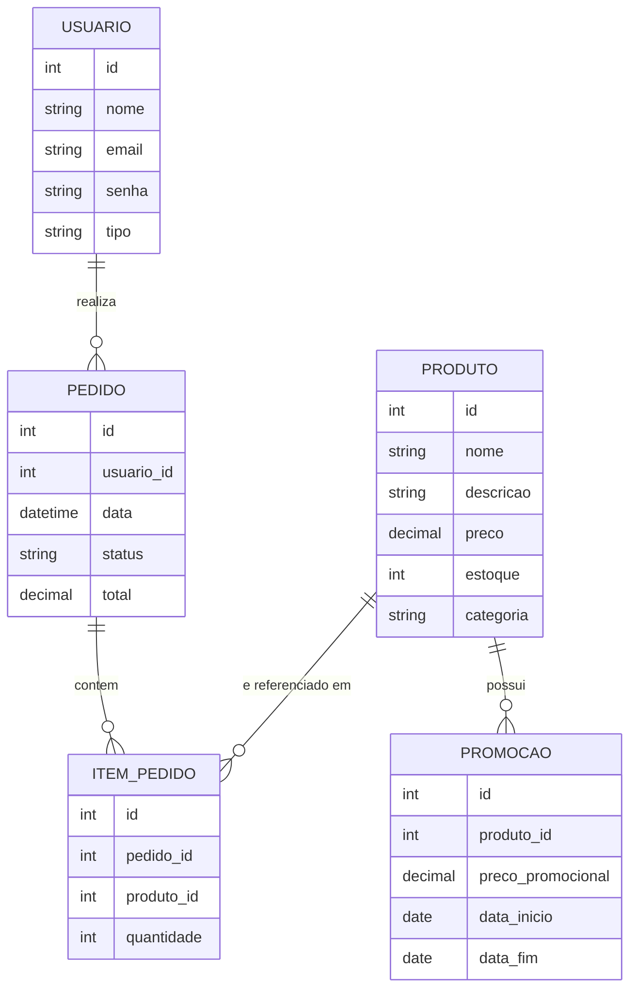
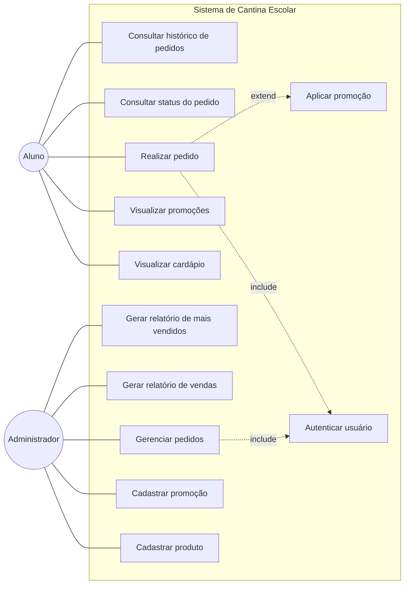

# Sistema de Cantina Escolar - Pré-pedidos e Gestão de Vendas

Sistema web para gerenciamento de vendas da cantina do IFC, permitindo que alunos façam pedidos antecipados de produtos e que a administração controle estoque, promoções e fluxo de atendimento.

**Professor:** [Marco André Mendes](github.com/marrcandre)

**Equipe:**
- [Arthur Lanznaster](github.com/arthurlanz)
- [Gabriel Sombrio](github.com/gaSombrio)

**Links do projeto:**
- [Documentação](https://github.com/Panificadora-Pires/.github)
- Backend: [Repositório](https://github.com/Panificadora-Pires/backend-pires) e Publicação
- Frontend: [Repositório](https://github.com/Panificadora-Pires/frontend-pires) e Publicação

---

## 1. Desenvolvimento

### 1.1 Modelo de Sistema escolhido

O sistema desenvolvido se enquadra no modelo de **Ponto de Vendas (PDV)**, adaptado para o contexto de uma cantina escolar. A escolha se justifica porque o núcleo do problema é o registro de vendas (pedidos) e o controle de estoque de produtos, características centrais desse tipo de sistema. A adaptação principal é a introdução do conceito de **pré-pedido**: o aluno reserva os itens antes de se dirigir à cantina, o que reduz filas no momento do intervalo e permite à administração prever a demanda com antecedência.

---

## 2. Situação Problema

A Cantina do IFC - Campus Araquari atende diariamente um grande número de alunos, concentrando praticamente todo o movimento nos intervalos entre as aulas, principalmente no recreio. O atendimento é feito de forma presencial e sequencial: o aluno chega ao balcão, escolhe os produtos disponíveis na hora, aguarda o registro da venda e só então recebe seu pedido. Não existe qualquer forma de reserva ou encomenda antecipada, e a divulgação das promoções do dia acontece de maneira informal, geralmente por cartazes ou boca a boca, o que limita o alcance da informação entre os alunos.

Como o intervalo tem duração curta e o número de alunos que tentam ser atendidos ao mesmo tempo é alto, formam-se filas longas logo nos primeiros minutos do recreio. Isso gera dois problemas centrais: parte dos alunos não consegue ser atendida a tempo e volta para a sala sem comprar nada, e os produtos mais procurados costumam acabar antes do fim do intervalo, prejudicando quem chega depois. Do lado da gestão, o controle de vendas e de estoque é feito manualmente, o que dificulta saber com precisão quais produtos vendem mais, quando repor itens e como planejar as promoções com base em dados reais em vez de estimativas.

Diante desse cenário, fica evidente a necessidade de uma ferramenta que permita ao aluno reservar seus produtos antes do intervalo e à administração acompanhar pedidos, estoque e vendas de forma organizada e automática, reduzindo filas e melhorando a tomada de decisão sobre o que oferecer e em que quantidade.

---

## 3. Descrição da proposta

O sistema tem como foco de ação permitir que alunos reservem produtos da cantina antes do horário de retirada, e que a administração acompanhe e gerencie esses pedidos, o estoque e as promoções em tempo real.

O software terá dois níveis de usuário:

- **Aluno:** consulta o cardápio e as promoções do dia, realiza pedidos antecipados e acompanha o status de cada pedido até a retirada.
- **Administrador:** cadastra produtos, define promoções, controla o estoque, gerencia os pedidos recebidos (alterando seu status conforme são preparados e retirados) e consulta relatórios de vendas.

De forma resumida, o aluno usará o sistema para não perder tempo em filas, e a administração o usará para organizar o fluxo de atendimento e ter visibilidade sobre o que está sendo vendido.

---

## 4. Modelagem de Dados

### 4.1 Entidades e relacionamentos

- **Usuario** (id, nome, email, senha, tipo) — representa tanto alunos quanto administradores, diferenciados pelo campo `tipo`.
- **Produto** (id, nome, descricao, preco, estoque, categoria)
- **Pedido** (id, usuario_id, data, status, total) — um pedido pertence a um usuário.
- **ItemPedido** (id, pedido_id, produto_id, quantidade) — tabela associativa entre Pedido e Produto.
- **Promocao** (id, produto_id, preco_promocional, data_inicio, data_fim)

Relacionamentos:
- Um **Usuario** realiza vários **Pedidos** (1:N).
- Um **Pedido** contém vários **ItemPedido** (1:N).
- Um **Produto** pode aparecer em vários **ItemPedido**, de vários pedidos diferentes (1:N).
- Um **Produto** pode ter várias **Promocao** ao longo do tempo, mas apenas uma ativa por vez (1:N).

### 4.2 Diagrama de Entidade-Relacionamento (DER)

---

## 5. Regras de negócio

**RN01 – Cadastro de pedido**
Data de criação: 06/07/2026 | Versão: 1 | Dependências: nenhuma
Um pedido só pode ser criado por usuários autenticados no sistema.

**RN02 – Controle de estoque**
Data de criação: 06/07/2026 | Versão: 1 | Dependências: RN01
Ao confirmar um pedido, a quantidade de cada produto envolvido deve ser reduzida automaticamente do estoque.

**RN03 – Limite de reserva**
Data de criação: 06/07/2026 | Versão: 1 | Dependências: RN02
Não é permitido reservar produtos cujo estoque esteja igual a zero.

**RN04 – Status do pedido**
Data de criação: 06/07/2026 | Versão: 1 | Dependências: RN01
O pedido deve seguir obrigatoriamente a sequência de estados: pendente → confirmado → pronto → retirado.

**RN05 – Cadastro de promoções**
Data de criação: 06/07/2026 | Versão: 1 | Dependências: nenhuma
Somente o administrador pode cadastrar, alterar ou remover promoções.

**RN06 – Validade do pedido**
Data de criação: 06/07/2026 | Versão: 1 | Dependências: RN04
Pedidos com status "pronto" que não forem retirados em até X minutos podem ser cancelados automaticamente pelo sistema.

**RN07 – Integridade do pedido**
Data de criação: 06/07/2026 | Versão: 1 | Dependências: RN04
Não é permitido alterar os itens de um pedido depois que ele for confirmado pelo aluno.

---

## 6. Requisitos funcionais

### Entradas

**R.F. 01 – Registro de usuário:** permite que um novo aluno crie sua conta de acesso ao sistema.
Dados necessários: nome, email, senha.
Usuários: aluno.

**R.F. 02 – Cadastro de produto:** permite ao administrador cadastrar novos produtos disponíveis na cantina.
Dados necessários: nome, descrição, preço, estoque, categoria.
Usuários: administrador.

**R.F. 03 – Cadastro de promoção:** permite ao administrador definir uma promoção para um produto existente.
Dados necessários: produto, preço promocional, data de início, data de fim.
Usuários: administrador.

**R.F. 04 – Criação de pedido:** permite ao aluno registrar uma reserva de um ou mais produtos.
Dados necessários: usuário, lista de produtos e quantidades.
Usuários: aluno.

### Processos

**R.F. 05 – Autenticação de usuário:** verifica as credenciais do usuário e direciona para a área correspondente ao seu tipo de acesso.
Dados necessários: email, senha, tipo de usuário.
Usuários: todos os níveis de usuário.

**R.F. 06 – Validação e baixa de estoque:** ao confirmar um pedido, verifica a disponibilidade dos produtos e reduz automaticamente as quantidades em estoque.
Dados necessários: produto, quantidade solicitada, estoque atual.
Usuários: sistema (acionado a partir da ação do aluno ou administrador).

**R.F. 07 – Atualização de status do pedido:** permite ao administrador alterar o status de um pedido conforme ele é preparado e retirado.
Dados necessários: pedido, novo status.
Usuários: administrador.

**R.F. 08 – Cálculo do total do pedido:** calcula o valor total do pedido, aplicando promoções ativas quando existirem.
Dados necessários: itens do pedido, preços, promoções vigentes.
Usuários: sistema.

### Saídas

**R.F. 09 – Consulta de cardápio do dia:** exibe os produtos disponíveis e suas respectivas promoções.
Dados necessários: nome, preço, categoria, promoção ativa.
Usuários: todos os níveis de usuário.

**R.F. 10 – Acompanhamento de status do pedido:** exibe ao aluno a situação atual de seu pedido.
Dados necessários: pedido, status.
Usuários: aluno.

**R.F. 11 – Relatório de vendas:** exibe ao administrador o volume de vendas por período selecionado.
Dados necessários: pedidos, datas, valores totais.
Usuários: administrador.

**R.F. 12 – Relatório de produtos mais vendidos:** exibe um ranking dos produtos com maior número de vendas.
Dados necessários: produtos, quantidade vendida.
Usuários: administrador.

---

## 7. Requisitos não funcionais

**R.N.F. 01 – Navegadores homologados:** o sistema deverá ser homologado para os navegadores Google Chrome e Mozilla Firefox.

**R.N.F. 02 – Tecnologia Front-end:** o front-end será desenvolvido com o framework Vue.js, utilizando HTML5 e CSS3.

**R.N.F. 03 – Tecnologia Back-end:** o back-end será desenvolvido em Python, utilizando o framework Django e a API REST construída com Django REST Framework.

**R.N.F. 04 – Banco de dados:** o sistema utilizará um banco de dados relacional (PostgreSQL).

**R.N.F. 05 – Arquitetura:** o sistema seguirá uma arquitetura cliente-servidor desacoplada, com comunicação entre frontend e backend via API REST.

**R.N.F. 06 – Autenticação:** o acesso ao sistema exigirá login e senha, com diferentes permissões de acordo com o tipo de usuário (aluno ou administrador).

**R.N.F. 07 – Disponibilidade:** o sistema deverá estar disponível durante o horário de funcionamento da cantina, com tempo de resposta baixo nas consultas de cardápio.

**R.N.F. 08 – Responsividade:** a interface deverá se adaptar a diferentes tamanhos de tela, funcionando bem tanto em celular quanto em desktop.

**R.N.F. 09 – Legais:** o sistema deve atender às exigências da Lei Geral de Proteção de Dados (LGPD) no tratamento das informações dos usuários.

---

## 8. Diagrama de Caso de Uso

### 8.1 Atores

- **Aluno:** interage com o sistema para consultar o cardápio, fazer pedidos e acompanhar seu status.
- **Administrador:** interage com o sistema para gerenciar produtos, promoções, pedidos e relatórios.

### 8.2 Casos de uso do Aluno

- Visualizar cardápio
- Visualizar promoções
- Realizar pedido
- Consultar status do pedido
- Consultar histórico de pedidos

### 8.3 Casos de uso do Administrador

- Cadastrar produto
- Cadastrar promoção
- Gerenciar pedidos (alterar status)
- Gerar relatório de vendas
- Gerar relatório de produtos mais vendidos

### 8.4 Relacionamentos identificados

- **Inclusão:** tanto "Realizar pedido" quanto "Gerenciar pedidos" incluem o caso de uso "Autenticar usuário", já que ambos exigem login prévio.
- **Extensão:** "Realizar pedido" é estendido por "Aplicar promoção", que só ocorre quando existe uma promoção ativa para o produto escolhido.

### 8.5 Diagrama

---

## 9. Expansões possíveis (opcional, fora do escopo inicial)

- QR Code para retirada de pedidos
- Notificação quando o pedido estiver pronto
- Sistema de fidelidade por pontos
- Painel com gráficos de vendas em tempo real
