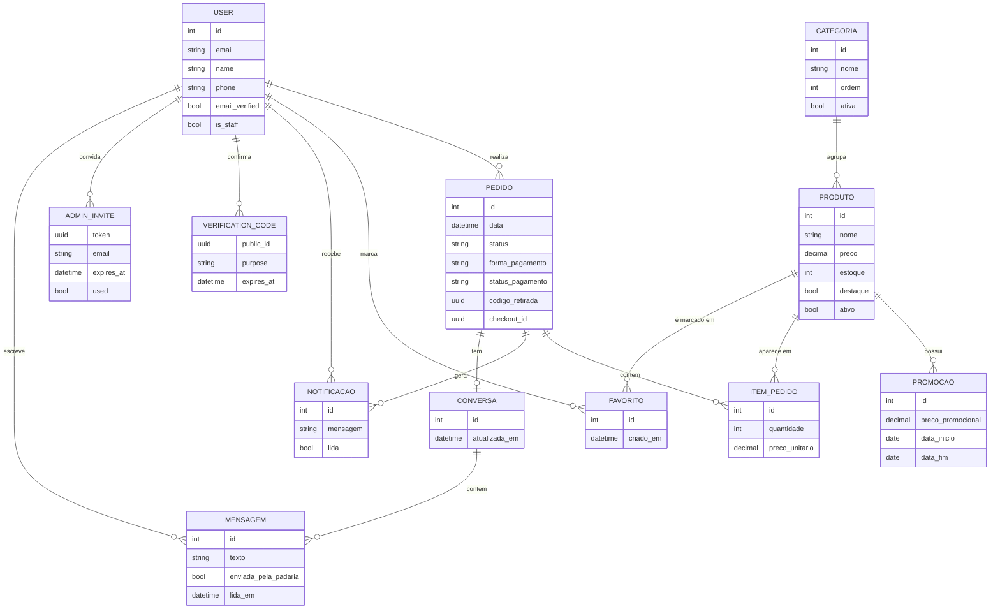
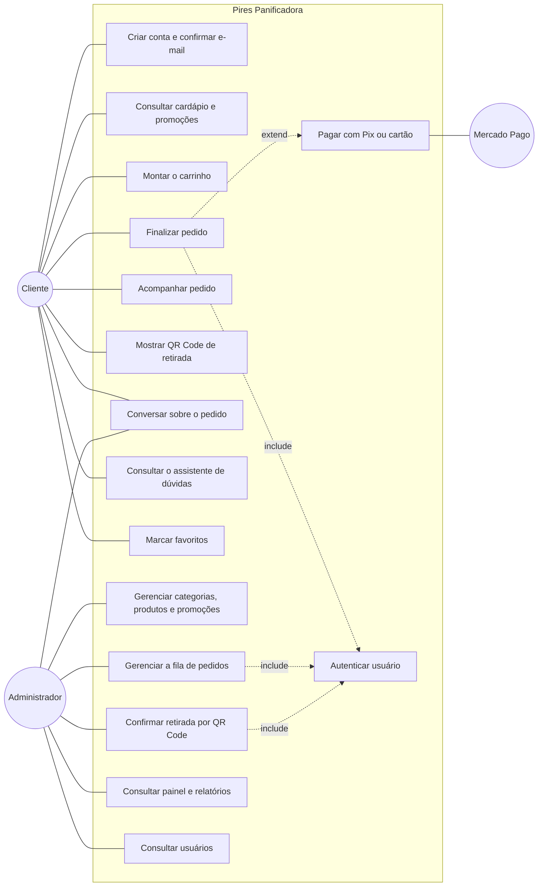

# Panificadora Pires — Pedidos antecipados com retirada por QR Code

Sistema web (PWA) em que alunos e a comunidade escolar do IFC Araquari escolhem o lanche, pagam por Pix, cartão ou em dinheiro na retirada e buscam o pedido no balcão mostrando um QR Code. A equipe da padaria acompanha a fila de produção, confirma a retirada, conversa com o cliente sobre o pedido e consulta relatórios de vendas.

Projeto Integrador do Curso Técnico em Informática Integrado ao Ensino Médio do IFC — Campus Araquari. Projeto acadêmico, sem fins lucrativos.

**Professor:** [Marco André Mendes](https://github.com/marrcandre)

**Equipe:**
- [Arthur Lanznaster](https://github.com/arthurlanz)
- [Gabriel Sombrio](https://github.com/gaSombrio)

**Links do projeto:**
- [Documentação (este documento)](https://github.com/Panificadora-Pires/.github)
- Backend: [Repositório](https://github.com/Panificadora-Pires/backend-pires) e [Publicação](https://backend-pires.class.fabricadesoftware.ifc.edu.br/api/health/)
- Frontend: [Repositório](https://github.com/Panificadora-Pires/frontend-pires) e [Publicação](https://panificadora-pires.vercel.app)

---

## 1. Desenvolvimento

### 1.1 Modelo de sistema escolhido

O sistema se enquadra no modelo de **Ponto de Vendas (PDV)**, adaptado para o atendimento de uma padaria no intervalo escolar. O núcleo do problema é registrar vendas (pedidos), controlar o estoque e receber pagamentos, que são as características centrais de um PDV. A adaptação principal é o **pedido antecipado**: o cliente faz e paga o pedido antes de ir ao balcão e só o retira quando ele estiver pronto, o que reduz a fila no intervalo e permite à padaria preparar os pedidos com antecedência.

---

## 2. Situação Problema

A Pires Panificadora atende diariamente os alunos e servidores do IFC — Campus Araquari. Quase todo o movimento se concentra nos intervalos entre as aulas, principalmente no recreio. A equipe é pequena: uma pessoa no caixa, que também atende o balcão, e outras na produção dos salgados, doces e bebidas.

Hoje o atendimento é presencial e sequencial. O cliente chega ao balcão, escolhe entre os produtos expostos, espera o registro da venda, paga e só então recebe o lanche. Não existe reserva nem encomenda: quem chega primeiro leva os produtos mais procurados, como a coxinha, que costuma acabar nos primeiros minutos. As promoções do dia são divulgadas em cartazes e no boca a boca, então muita gente só fica sabendo delas no balcão.

Como o intervalo é curto e muitos alunos tentam ser atendidos ao mesmo tempo, a fila se forma logo no início. Parte dos alunos volta para a sala sem comprar, e a equipe trabalha sob pressão, sem saber com antecedência quanto vai vender. Do lado da gestão, as vendas e o estoque são controlados de forma manual: é difícil saber quais produtos vendem mais, quando repor e se uma promoção deu resultado. O pagamento em dinheiro exige troco, o que atrasa ainda mais a fila.

Os problemas centrais são, portanto, a fila concentrada no intervalo, a falta de previsão da demanda, o controle manual de estoque e vendas e a lentidão no pagamento. Um sistema em que o cliente faça e pague o pedido antes, e em que a padaria receba os pedidos organizados por etapa, resolve a maior parte deles: o balcão passa a só entregar pedidos prontos, e os dados de venda ficam registrados automaticamente.

---

## 3. Descrição da proposta

O foco do sistema é permitir que o cliente faça e pague o pedido antes do intervalo e o retire no balcão mostrando um QR Code, enquanto a padaria acompanha os pedidos por etapa, controla o estoque e consulta os resultados das vendas.

O software tem dois níveis de usuário:

- **Cliente** (aluno ou servidor): cria a conta com e-mail confirmado ou entra com o Google, consulta o cardápio e as promoções, monta o carrinho, paga por Pix, cartão ou escolhe pagar em dinheiro na retirada, acompanha o pedido em tempo real, recebe notificações, conversa com a padaria pelo chat do pedido, tira dúvidas no assistente e mostra o QR Code para retirar.
- **Administrador** (equipe da padaria): cadastra categorias, produtos e promoções, acompanha a fila de pedidos por etapa (pendente, em preparo, pronto), confirma a retirada lendo o QR Code com a câmera, responde ao chat dos pedidos e consulta o painel, os relatórios de vendas e os usuários.

O sistema funciona no navegador do celular e do computador e pode ser instalado como aplicativo (PWA).

---

## 4. Modelagem de Dados

### 4.1 Entidades e relacionamentos

- **User** (email, name, phone, avatar, google_avatar_url, google_sub, email_verified, is_active, is_staff): representa clientes e administradores; `is_staff` indica o administrador.
- **VerificationCode** (user, purpose, code_hash, expires_at, attempts, used_at): código enviado por e-mail para confirmar a conta ou redefinir a senha.
- **AdminInvite** (token, email, created_by, expires_at, used): convite para um novo administrador.
- **Categoria** (nome, slug, descricao, ordem, ativa).
- **Produto** (codigo, nome, slug, descricao, categoria, imagem, unidade_medida, preco, preco_custo, estoque, estoque_minimo, destaque, ativo).
- **Promocao** (produto, preco_promocional, data_inicio, data_fim).
- **Pedido** (usuario, data, status, status_atualizado_em, codigo_retirada, checkout_id, forma_pagamento, status_pagamento, dados do Mercado Pago, pix_qr_code, estoque_devolvido).
- **ItemPedido** (pedido, produto, quantidade, preco_unitario): associa pedidos e produtos, com o preço congelado no momento do pedido.
- **Favorito** (usuario, produto).
- **Notificacao** (usuario, pedido, mensagem, lida).
- **Conversa** (pedido) e **Mensagem** (conversa, autor, enviada_pela_padaria, texto, lida_em): chat de cada pedido.
- **PerguntaFrequente** (chave, pergunta, palavras_chave, resposta, ordem, ativa): base do assistente de dúvidas.

Relacionamentos:
- Um **User** realiza vários **Pedidos** e tem vários **Favoritos**, **Notificações** e **VerificationCodes** (1:N).
- Um **Pedido** contém vários **ItemPedido** (1:N) e tem no máximo uma **Conversa** (1:1), que tem várias **Mensagens** (1:N).
- Uma **Categoria** agrupa vários **Produtos** (1:N).
- Um **Produto** aparece em vários **ItemPedido** e pode ter várias **Promoções** ao longo do tempo, sem sobreposição de datas (1:N).

### 4.2 Diagrama de Entidade-Relacionamento (DER)

A entidade **PerguntaFrequente** é independente: guarda as respostas do assistente de dúvidas e é editada pela administração.

---

## 5. Regras de negócio

**RN01 – Conta confirmada**
Versão 2 (revisada em 25/11/2026) | Dependências: nenhuma
Só faz pedidos quem tem conta ativa. A conta criada com e-mail e senha só é ativada depois de confirmada com o código enviado por e-mail, que vale 10 minutos e aceita até 5 tentativas. A entrada com o Google dispensa o código.

**RN02 – Preço definido pelo sistema**
Versão 2 (revisada em 25/11/2026) | Dependências: RN01
O preço, o estoque e a situação do pagamento são sempre calculados pelo servidor. O preço de cada item fica registrado no momento do pedido, já com a promoção vigente, e não muda depois.

**RN03 – Reserva de estoque**
Versão 2 (revisada em 25/11/2026) | Dependências: RN02
Ao criar o pedido, a quantidade de cada produto é reservada no estoque. Não é possível pedir um produto sem estoque suficiente. Se o pedido for cancelado, o estoque é devolvido uma única vez.

**RN04 – Limites do pedido**
Versão 1 | Dependências: RN03
Cada pedido aceita até 50 unidades por produto e até 30 produtos diferentes. Cada cliente pode ter no máximo 5 pedidos pendentes ao mesmo tempo.

**RN05 – Etapas do pedido**
Versão 2 (revisada em 25/11/2026) | Dependências: RN01
O pedido segue obrigatoriamente a sequência pendente → confirmado → pronto → retirado. Ele pode ser cancelado em qualquer etapa antes da retirada. Só a administração muda a etapa do pedido.

**RN06 – Confirmação do pagamento**
Versão 1 | Dependências: RN05
O pedido pago por Pix ou cartão só passa para "confirmado" quando o Mercado Pago aprova o pagamento. O pedido em dinheiro é pago no balcão, e o pagamento é registrado na retirada.

**RN07 – Prazo para pagar**
Versão 1 | Dependências: RN06
O pedido online que não for pago em 45 minutos é cancelado automaticamente, e o estoque é devolvido.

**RN08 – Prazo para retirar**
Versão 2 (revisada em 25/11/2026) | Dependências: RN05
O pedido pronto que não for retirado em 15 minutos é cancelado automaticamente.

**RN09 – Retirada com QR Code**
Versão 1 | Dependências: RN05
A retirada é confirmada pela administração lendo o QR Code do pedido, que só o cliente dono do pedido pode exibir. Só pedidos prontos podem ser retirados.

**RN10 – Estorno**
Versão 1 | Dependências: RN06
Se um pedido já pago online for cancelado, o valor é estornado integralmente pelo Mercado Pago antes do cancelamento.

**RN11 – Pagamento sem duplicidade**
Versão 1 | Dependências: RN06
Cada finalização de compra tem um identificador único. Se o cliente enviar a mesma finalização duas vezes, o sistema devolve o mesmo pedido em vez de criar outro.

**RN12 – Promoções**
Versão 2 (revisada em 25/11/2026) | Dependências: nenhuma
Só a administração cria, altera ou remove promoções. O preço promocional deve ser menor que o preço original, e um produto não pode ter duas promoções no mesmo período.

**RN13 – Chat do pedido**
Versão 1 | Dependências: RN05
Cada pedido tem uma conversa entre o cliente dono do pedido e a equipe da padaria. Depois que o pedido é retirado ou cancelado, a conversa aceita mensagens por mais 24 horas e então fica só para leitura.

**RN14 – Acesso aos dados**
Versão 1 | Dependências: RN01
O cliente vê apenas os próprios pedidos, notificações, favoritos e conversas. A administração vê todos os pedidos e é a única que acessa relatórios, usuários e o cadastro do catálogo.

**RN15 – Relatórios**
Versão 1 | Dependências: RN05
Os relatórios de vendas consideram apenas pedidos retirados, pela data da retirada.

---

## 6. Requisitos funcionais

### Entradas

**R.F. 01 – Cadastro de cliente:** permite criar a conta com e-mail e senha e confirmar o e-mail com um código, ou entrar com a conta Google.
- **Dados necessários:** nome, e-mail, telefone, senha, código de verificação.
- **Usuários:** cliente.

**R.F. 02 – Cadastro de categoria:** permite à administração criar e organizar as categorias do cardápio.
- **Dados necessários:** nome, descrição, ordem, situação (ativa ou inativa).
- **Usuários:** administrador.

**R.F. 03 – Cadastro de produto:** permite à administração cadastrar e editar produtos, com foto, preço e estoque.
- **Dados necessários:** código, nome, descrição, categoria, imagem, unidade, preço, preço de custo, estoque, estoque mínimo, destaque, situação.
- **Usuários:** administrador.

**R.F. 04 – Cadastro de promoção:** permite à administração definir um preço promocional para um produto em um período.
- **Dados necessários:** produto, preço promocional, data de início, data de fim.
- **Usuários:** administrador.

**R.F. 05 – Montagem do carrinho:** permite ao cliente adicionar produtos, alterar quantidades e remover itens antes de finalizar.
- **Dados necessários:** produto, quantidade.
- **Usuários:** cliente.

**R.F. 06 – Edição do perfil:** permite ao cliente alterar nome, telefone e foto de perfil.
- **Dados necessários:** nome, telefone, foto.
- **Usuários:** cliente.

**R.F. 07 – Convite de administrador:** permite a um administrador convidar outra pessoa para a administração, pela API.
- **Dados necessários:** e-mail do convidado.
- **Usuários:** administrador.

### Processos

**R.F. 08 – Autenticação de usuário:** verifica as credenciais e direciona o usuário para a área de cliente ou de administração.
- **Dados necessários:** e-mail e senha, ou conta Google; nível de permissão.
- **Usuários:** todos os níveis de usuário.

**R.F. 09 – Finalização do pedido:** cria o pedido, reserva o estoque e inicia o pagamento por Pix ou cartão pelo Mercado Pago, ou registra o pagamento em dinheiro na retirada.
- **Dados necessários:** itens do carrinho, forma de pagamento, identificador da finalização, dados do pagamento.
- **Usuários:** cliente.

**R.F. 10 – Confirmação do pagamento:** consulta o Mercado Pago e recebe os avisos dele (webhook) para confirmar, recusar ou estornar o pagamento.
- **Dados necessários:** pedido, identificadores do Mercado Pago, situação do pagamento.
- **Usuários:** sistema.

**R.F. 11 – Gestão da fila de pedidos:** permite à administração mover o pedido pelas etapas (confirmar, marcar como pronto, cancelar).
- **Dados necessários:** pedido, nova etapa.
- **Usuários:** administrador.

**R.F. 12 – Retirada por QR Code:** confirma a retirada lendo com a câmera o QR Code mostrado pelo cliente.
- **Dados necessários:** código de retirada do pedido.
- **Usuários:** administrador.

**R.F. 13 – Cancelamento automático:** cancela pedidos não pagos em 45 minutos e pedidos prontos não retirados em 15 minutos, devolvendo o estoque e estornando quando necessário.
- **Dados necessários:** pedidos, etapa, situação do pagamento, data da última mudança.
- **Usuários:** sistema.

**R.F. 14 – Chat do pedido:** permite ao cliente e à equipe trocar mensagens sobre um pedido.
- **Dados necessários:** pedido, autor, texto.
- **Usuários:** cliente e administrador.

**R.F. 15 – Assistente de dúvidas:** responde perguntas frequentes do cliente (horário, pagamento, retirada) a partir de regras e palavras-chave.
- **Dados necessários:** pergunta, base de perguntas frequentes.
- **Usuários:** cliente.

**R.F. 16 – Favoritos:** permite ao cliente marcar e desmarcar produtos favoritos.
- **Dados necessários:** cliente, produto.
- **Usuários:** cliente.

### Saídas

**R.F. 17 – Cardápio e promoções:** exibe os produtos disponíveis por categoria, com busca, ordenação e as promoções vigentes.
- **Dados necessários:** nome, foto, preço, preço promocional, categoria, disponibilidade.
- **Usuários:** cliente.

**R.F. 18 – Acompanhamento do pedido:** exibe ao cliente a etapa atual de cada pedido, o histórico e o QR Code de retirada quando o pedido está pronto, com atualização em tempo real.
- **Dados necessários:** pedido, itens, etapa, situação do pagamento, código de retirada.
- **Usuários:** cliente.

**R.F. 19 – Notificações:** avisa o cliente quando o pedido fica pronto e quando a padaria responde no chat.
- **Dados necessários:** mensagem, pedido, situação de leitura.
- **Usuários:** cliente.

**R.F. 20 – Painel da administração:** exibe os pedidos por etapa, as mensagens não lidas, os indicadores de venda e os produtos mais vendidos.
- **Dados necessários:** pedidos, etapas, mensagens, totais.
- **Usuários:** administrador.

**R.F. 21 – Relatório de vendas:** exibe o faturamento, a quantidade de pedidos e os produtos mais vendidos em um período, com comparação ao período anterior.
- **Dados necessários:** pedidos retirados, itens, valores, datas.
- **Usuários:** administrador.

**R.F. 22 – Consulta de usuários:** exibe as contas cadastradas, com busca e filtros por perfil, situação e verificação.
- **Dados necessários:** nome, e-mail, perfil, situação, último acesso.
- **Usuários:** administrador.

---

## 7. Requisitos não funcionais

**R.N.F. 01 – Navegadores homologados:** o sistema é homologado para o Google Chrome e o Mozilla Firefox, no computador e no celular.

**R.N.F. 02 – Tecnologia front-end:** o front-end é desenvolvido com Vue 3, Vite, Pinia e Vue Router, com HTML5 e CSS3 próprios, sem framework de CSS.

**R.N.F. 03 – Tecnologia back-end:** o back-end é desenvolvido em Python 3.12, com Django 5.2 e Django REST Framework, autenticação JWT e gerenciador de pacotes PDM.

**R.N.F. 04 – Banco de dados:** o sistema usa PostgreSQL em produção e SQLite no desenvolvimento.

**R.N.F. 05 – Arquitetura:** cliente-servidor desacoplado, com comunicação por API REST e atualização em tempo real por WebSocket, com volta automática para consultas periódicas quando o tempo real não está disponível.

**R.N.F. 06 – Pagamentos:** os pagamentos por Pix e cartão são processados pelo Mercado Pago. O sistema não recebe nem guarda o número do cartão.

**R.N.F. 07 – Segurança:** senhas guardadas como hash, conexão HTTPS, permissões verificadas no servidor, limite de requisições por usuário e webhook do Mercado Pago validado por assinatura.

**R.N.F. 08 – Hospedagem:** o back-end é publicado no Fabroku (IFC) e o front-end na Vercel. As imagens ficam no Cloudinary.

**R.N.F. 09 – Instalação como aplicativo:** o front-end é um PWA e pode ser instalado no celular.

**R.N.F. 10 – Responsividade e acessibilidade:** a interface se adapta a telas de celular a partir de 320 px e ao computador, com navegação por teclado, foco visível e respeito à preferência de movimento reduzido.

**R.N.F. 11 – Disponibilidade:** o sistema deve estar disponível durante o funcionamento da padaria, com o cardápio respondendo rapidamente nos horários de intervalo.

**R.N.F. 12 – Legais:** o sistema atende à LGPD, com Termos de Uso, Política de Privacidade e Política de Cookies publicados e aceite no cadastro.

**R.N.F. 13 – Ambiente de desenvolvimento:** o sistema é desenvolvido no Visual Studio Code, com versionamento no GitHub e verificação automática (testes e build) a cada pull request.

---

## 8. Diagrama de Caso de Uso

### 8.1 Atores

- **Cliente:** consulta o cardápio, faz e paga pedidos, acompanha e retira os pedidos e conversa com a padaria.
- **Administrador:** gerencia o catálogo, a fila de pedidos, a retirada, o chat e os relatórios.
- **Mercado Pago:** sistema externo que processa e confirma os pagamentos.

### 8.2 Casos de uso do Cliente

- Criar conta e confirmar e-mail
- Entrar com e-mail ou com o Google
- Consultar cardápio e promoções
- Montar o carrinho
- Finalizar pedido
- Pagar com Pix ou cartão
- Acompanhar pedido
- Mostrar QR Code de retirada
- Conversar sobre o pedido
- Consultar o assistente de dúvidas
- Marcar favoritos
- Editar perfil

### 8.3 Casos de uso do Administrador

- Gerenciar categorias, produtos e promoções
- Gerenciar a fila de pedidos
- Confirmar retirada por QR Code
- Responder ao chat do pedido
- Consultar painel e relatórios de vendas
- Consultar usuários

### 8.4 Relacionamentos identificados

- **Inclusão:** "Finalizar pedido", "Gerenciar a fila de pedidos" e "Confirmar retirada por QR Code" incluem "Autenticar usuário", pois exigem login.
- **Extensão:** "Finalizar pedido" é estendido por "Pagar com Pix ou cartão", que só acontece quando o cliente não escolhe pagar em dinheiro na retirada.
- **Associação com sistema externo:** "Pagar com Pix ou cartão" se comunica com o Mercado Pago.

### 8.5 Diagrama

---

## 9. Expansões possíveis (fora do escopo atual)

- Escolha do horário de retirada.
- Repetir um pedido anterior e adicionar observações aos itens.
- Notificações push no celular (Web Push).
- Avaliação do pedido pelo cliente.
- Tela para convidar administradores (hoje o convite é feito pela API).
- Alerta de estoque baixo e relatório de lucro a partir do preço de custo.
- Exportação dos relatórios em CSV e PDF.
- Cupons de desconto e programa de fidelidade.
